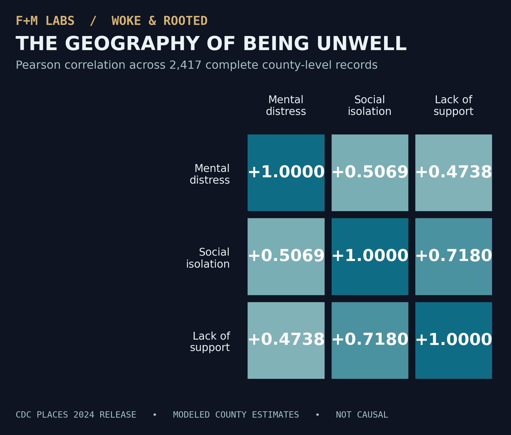

# The Geography of Being Unwell
### Mental Distress, Social Isolation & Emotional Support Across U.S. Counties

**Woke & Rooted × F+M Labs** · SQL / public-health analytics portfolio · Project 001



> **Research question:** Where do county-level estimates of frequent mental distress, social isolation and lack of social/emotional support intersect—and what can those relationships actually tell us?

This project uses the **CDC PLACES County Data 2024 release** (`fu4u-a9bh`) to construct a reproducible SQLite data pipeline, audit missingness, investigate geographic patterns and measure pairwise associations. The original source is public. No individual medical records are used.

## Key findings

Analysis conducted in Ubuntu/SQLite on **November 7, 2026**, using a 2024-release CDC file:

| Data audit / descriptive result | Value |
|---|---:|
| County / county-equivalent records | 3,144 |
| Complete on all three selected indicators | 2,417 (76.9%) |
| Missing frequent mental distress | 0 |
| Missing social isolation | 727 |
| Missing lack of emotional support | 727 |
| Missing **both** isolation and support | 727 |
| Mean frequent mental distress, complete cases | 17.31% |
| Mean social isolation, complete cases | 32.88% |
| Mean lack of social/emotional support, complete cases | 25.01% |

**Pearson correlations (complete-case county sample; n = 2,417):**

| Association | Pearson *r* |
|---|---:|
| Mental distress × isolation | +0.5069 |
| Mental distress × lack of support | +0.4738 |
| Isolation × lack of support | **+0.7180** |

County areas with modeled isolation at or above **32.88%** averaged **18.17%** mental distress (1,187 areas), versus **16.47%** (1,230 areas) below that cutoff—a **1.70 percentage-point** descriptive difference. The cutoff is a rounded sample mean, not a clinical threshold.

Among the highest-scoring areas on mental distress in the complete-case sample were **Kusilvak Census Area, Alaska (26.2%)**, **Apache County, Arizona (25.7%)**, and **Madison County, Idaho (25.7%)**. See [`docs/RESULTS.md`](docs/RESULTS.md).

**Interpretation:** Across these modeled county estimates, greater social disconnection tends to coincide with greater mental distress. **None of these correlations establishes causation**, identifies what any individual resident experiences, or demonstrates the effect of faith, community, or nonprofit interventions.

## Source and scope

- Official dataset: [CDC PLACES, County Data, 2024 release](https://data.cdc.gov/d/fu4u-a9bh)
- Official CSV: `https://data.cdc.gov/api/v3/views/fu4u-a9bh/export.csv?accessType=DOWNLOAD`
- [CDC PLACES data overview](https://www.cdc.gov/places/about/)
- [CDC release notes](https://www.cdc.gov/places/current-release-notes/)
- [CDC FAQs / modeling and geographic coverage](https://www.cdc.gov/places/faqs/general-faqs/index.html)
- Indicators: `MHLTH` (frequent mental distress), `ISOLATION` (social isolation), `EMOTIONSPT` (lack of social/emotional support). Data type: crude prevalence estimates.

**Release year ≠ survey year.** The 2024 release is primarily based on 2022 BRFSS survey data. In that release, the new modeled health-related social needs measures were available for **39 states and Washington, D.C.**, not all states. Accordingly, missing social-need measures reflect a serious geographic coverage limitation: the 2,417 complete-case counties must not be described as a representative sample of every U.S. county or every U.S. resident.

## Reproduce the analysis

Requirements: Ubuntu/macOS/Windows with **Python 3.10+** and SQLite (Python's bundled `sqlite3` handles the pipeline; CLI useful for exploring the database).

```bash
python3 src/pipeline.py --download
python3 src/pipeline.py --build
python3 src/pipeline.py --report
python3 -m unittest discover -s tests -v
sqlite3 -header -column data/woke_rooted.sqlite < sql/04_findings.sql
python3 src/generate_figures.py
```

The first command requires an internet connection. The script ignores national-level summary records (`StateAbbr = US`) before county validation. The raw file and generated `.sqlite` database are intentionally **not** committed: the source can be downloaded and the analysis rerun locally. Offline unit tests use fabricated fixtures only.

The last step generates SVG charts from your locally built SQLite database in `figures/`, including a full scatterplot and correlation heatmap. The committed PNG heatmap visualizes the real correlation results reported from the Ubuntu analysis; if the source data changes, regenerate the SVGs and update figures and findings before publishing revised claims.

## Project files

| File / directory | What it demonstrates |
|---|---|
| `src/pipeline.py` | CDC CSV ingestion, standardization, county filtering, SQLite load |
| `src/generate_figures.py` | Reproducible data-driven SVG charts |
| `sql/01_schema.sql` | County dimension and observation tables + analytics view |
| `sql/02_analysis.sql` | Exploratory queries and county rankings |
| `sql/03_validation.sql` | Data integrity checks |
| **`sql/04_findings.sql`** | Full reproducible research finding queries + correlations |
| **`docs/RESULTS.md`** | Reported findings and analytical scope |
| **`docs/RESEARCH_MEMO.md`** | Interpretation and ASCEND evidence record |
| **`docs/WOKE_ROOTED_ARTICLE_DRAFT.md`** | Editorial companion draft, not yet published |
| **`docs/UPLOAD_FROM_TERMIUS.md`** | Safe VM → GitHub publishing guide |
| `.github/workflows/tests.yml` | Offline tests on each GitHub push |

## Methods and limitations

Each county record is identified by its five-character FIPS value. Percentages are county-level **modeled estimates**. The research does **not** include individual-level records. Pairwise Pearson coefficients use only the 2,417 counties with all three measures available. Group and national sample means are **unweighted across counties**; they are *not* population-weighted U.S. prevalence rates.

Other limitations: model uncertainty intervals are not used in this exploratory ranking, missingness differs geographically, strong correlation is not a causal effect, and the modeled outcomes may share underlying data and modeling assumptions. Comparisons across differently populated counties are descriptive; rankings must not stigmatize communities. Further work should examine confidence intervals, state composition, alternative weighting, and robust regression.

See [`docs/METHODS.md`](docs/METHODS.md) for definitions and quality checks, and [`docs/RESEARCH_MEMO.md`](docs/RESEARCH_MEMO.md) for a defensible interpretation.

## Editorial connection

The companion Woke & Rooted draft asks what it means for communities and institutions to claim they offer belonging. The data alone cannot explain cultural, spiritual or institutional causes; the essay treats them as questions for listening and further research rather than as findings.

## Licensing / attribution

Project code and original text are MIT licensed. Underlying data are from the **Centers for Disease Control and Prevention, PLACES County Data 2024 release**. This work is not affiliated with or endorsed by CDC. The research figure is derived from SQL results on the public dataset, not a CDC chart.
