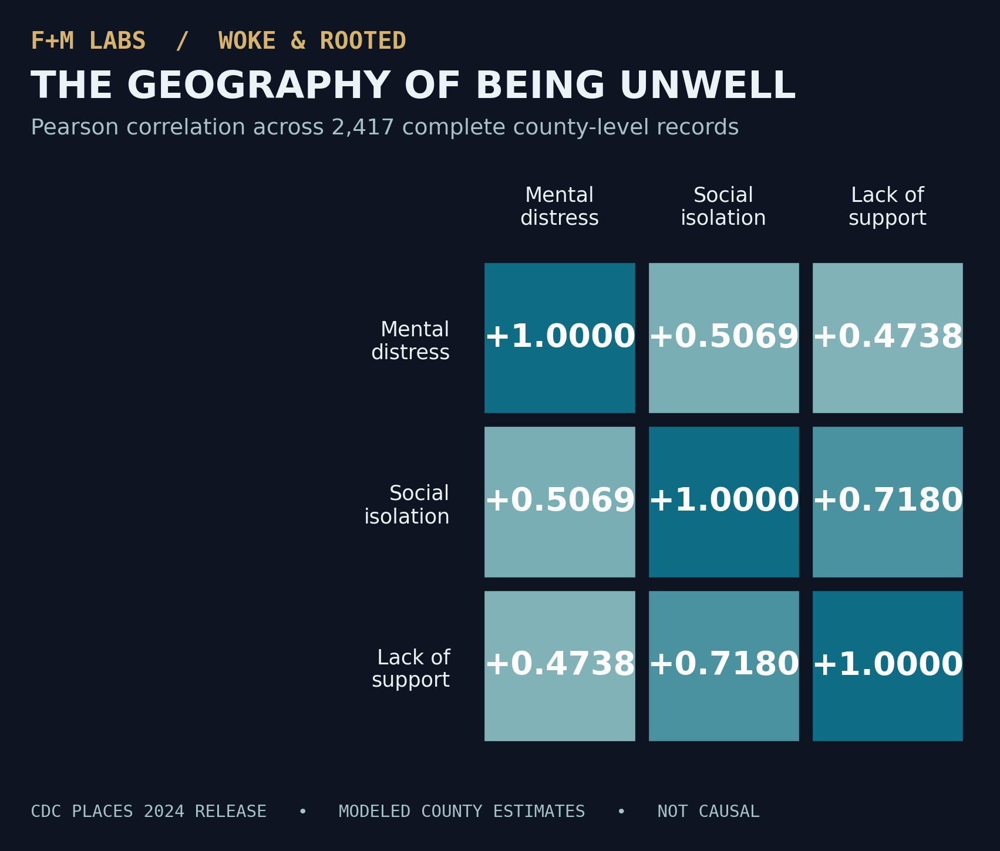

# Results | The Geography of Being Unwell

**Dataset:** CDC PLACES county data, 2024 release (`fu4u-a9bh`)  
**Analysis environment:** Ubuntu VM, SQLite (queries and values reported November 7, 2026)  
**Important:** Re-run `sql/04_findings.sql` against the local real-data database to independently verify the results on your machine. The raw CDC file is intentionally not included in Git.

## Coverage and data quality

| Check | Observed |
|---|---:|
| Counties and county equivalents in analytical table | 3,144 |
| Complete observations across all three measures | 2,417 |
| Completeness | 76.9% |
| Mental distress estimates missing | 0 |
| Isolation estimates missing | 727 |
| Lack-of-support estimates missing | 727 |
| Missing isolation **and** support | 727 |
| Counties without a matching metrics record | 0 |

The same 727 county records lack both social-health indicators. **This is not evidence that those communities have no isolation or support needs.** The 2024 CDC release published new modeled social-needs estimates for only 39 states and Washington, D.C.; coverage restrictions help explain why these indicators are not available nationwide. Examine `sql/04_findings.sql` query 06 to identify geographic patterns of missingness in your specific extract.

## County-level average estimates, complete-case sample

| Indicator | Unweighted mean of county estimates |
|---|---:|
| Frequent mental distress | 17.31% |
| Social isolation | 32.88% |
| Lack of social and emotional support | 25.01% |

These are **county averages**, not rates for the U.S. adult population. Every county contributes equally to the mean regardless of population.

## High-distress observations from complete-case ranking

A selection of the highest-ranked county areas from the Ubuntu SQL results:

| County / county equivalent | State | Distress % | Isolation % | Lack of support % |
|---|---|---:|---:|---:|
| Kusilvak | Alaska | 26.2 | 44.2 | 37.0 |
| Apache | Arizona | 25.7 | 39.3 | 34.4 |
| Madison | Idaho | 25.7 | 37.9 | 23.1 |
| McKinley | New Mexico | 25.1 | 47.7 | 33.4 |
| Glacier | Montana | 25.0 | 39.1 | 31.1 |
| Hancock | Tennessee | 23.9 | 34.7 | 27.1 |
| Nome | Alaska | 23.8 | 40.4 | 36.5 |
| Roosevelt | Montana | 23.4 | 34.9 | 29.0 |
| Cabell | West Virginia | 23.4 | 32.8 | 24.4 |
| Bethel | Alaska | 23.3 | 43.4 | 36.9 |
| Holmes | Ohio | 23.2 | 35.5 | 25.8 |
| Logan | West Virginia | 23.2 | 34.0 | 25.3 |
| McDowell | West Virginia | 23.2 | 32.8 | 27.7 |
| Mingo | West Virginia | 23.2 | 36.6 | 30.2 |
| Wyoming | West Virginia | 23.2 | 33.0 | 26.3 |

Ties at the lower rank boundary may change which counties appear in a `LIMIT 15` output when tie-breaking rules change. More than one county may share the same estimated rate. Rankings alone should not be used to infer which community is definitively worse off; uncertainty intervals were not evaluated here.

## Isolation group comparison

Threshold: **32.88%**, the sample's rounded mean isolation estimate.

| Group | County areas | Mean distress % | Mean isolation % |
|---|---:|---:|---:|
| Higher isolation (≥ 32.88%) | 1,187 | 18.17 | 35.11 |
| Lower isolation (< 32.88%) | 1,230 | 16.47 | 30.73 |

The **1.70 percentage-point difference** is descriptive and not a test of statistical significance.

## Pearson correlation matrix

| Indicator | Distress | Isolation | Lack of support |
|---|---:|---:|---:|
| Mental distress | 1.0000 | **0.5069** | **0.4738** |
| Social isolation | **0.5069** | 1.0000 | **0.7180** |
| Lack of support | **0.4738** | **0.7180** | 1.0000 |

Correlations are across *counties*, not people. A high correlation between modeled estimates may reflect shared determinants, geographic composition, and modeling inputs, as well as underlying social patterns. It does not reveal which causes which.

## Follow-on checks before making stronger claims

1. Inspect missingness by state and compare the geographic composition of included and excluded counties.
2. Confirm population weighting, model uncertainty/confidence intervals, and the possible influence of overlapping modeling inputs.
3. Evaluate potential confounders with appropriately chosen public data (without presuming a causal link).
4. Investigate whether relationships persist within states rather than only across the combined U.S. sample.

**Source:** https://data.cdc.gov/d/fu4u-a9bh  
**CDC overview:** https://www.cdc.gov/places/about/  
**CDC FAQs:** https://www.cdc.gov/places/faqs/general-faqs/index.html
