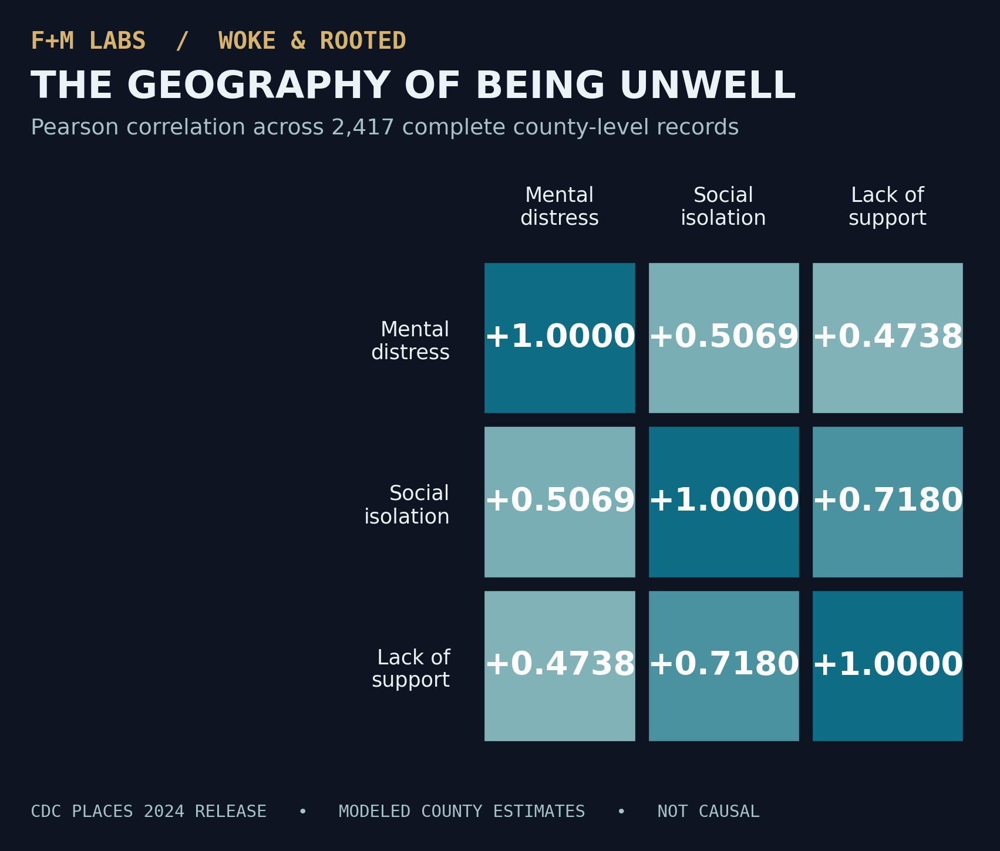

# The Geography of Being Unwell
### What county-level data can—and cannot—tell us about mental distress, isolation, and the support we need

*Woke & Rooted | Research essay draft, not yet published*  
*By F+M Labs × Woke & Rooted*

We tend to talk about mental health as though it lives behind a closed door. A private struggle. An individual decision. A quiet problem that someone is expected to solve with enough willpower, prayer, therapy, or resilience.

But what happens when we change the scale of the question? What happens when we ask not only whether a person is hurting, but whether the places around them offer belonging, companionship, and dependable care?

That question led me to the Centers for Disease Control and Prevention's **PLACES 2024 county dataset**. I used SQL to examine three modeled estimates across the United States: **frequent mental distress**, **social isolation**, and **lack of social and emotional support**.

The project is called *The Geography of Being Unwell*. It is a data analysis, not a diagnosis of any community. And it has already raised questions worth sitting with.

## The shape of the data

The dataset contained records for **3,144 counties and county equivalents**. However, only **2,417** had estimates available for all three measures. Mental distress estimates were present for all 3,144 records; **727** lacked both isolation and emotional-support estimates.

Those gaps are not trivial. The CDC's 2024 rollout of the new modeled health-related social needs measures covered **39 states and Washington, D.C.** This means that the communities absent from the comparison aren't simply a random group. The geographic coverage of the original data shapes what the analysis can reveal.

Across the counties with complete data, the average estimated frequent mental distress rate was **17.31%**. The average social isolation estimate was **32.88%**, while the average estimate for lack of social and emotional support was **25.01%**.

These are **unweighted averages of county estimates**. They are not the percentage of all U.S. adults experiencing these conditions. A sparsely populated county and a populous one contribute equally to the county average.

## Where disconnection and distress meet

When I divided counties into two groups using the sample's rounded average isolation estimate—32.88%—the higher-isolation counties had an average mental distress estimate of **18.17%**. The lower-isolation group averaged **16.47%**.

That's a **1.70 percentage-point difference**.

To look beyond that single split, I calculated the correlations among all three indicators across the 2,417 complete cases. Social isolation and mental distress had a Pearson correlation of **+0.5069**. Lack of emotional support and mental distress had a correlation of **+0.4738**. Social isolation and lack of emotional support were more closely connected, with a correlation of **+0.7180**.

*Figure: Correlations among three CDC PLACES modeled county-level indicators, using the complete-case sample (n = 2,417). A positive correlation describes how county estimates vary together; it does not establish cause and effect.*

These patterns suggest that emotional distress and social disconnection often occur in the same geographic picture. The strongest observed relationship is between isolation and inadequate support—two related, but not identical, experiences.

Still, the numbers don't tell us who is sitting alone in a house, who has a community but doesn't feel safe asking for help, or who has been failed by a supposedly supportive institution.

The numbers tell us where questions may deserve attention. They do not tell us the full story.

## A note about who gets seen

In the complete-case ranking, Kusilvak Census Area in Alaska had an estimated frequent mental distress rate of **26.2%**, along with **44.2%** isolation and **37.0%** lack of support. Other highly ranked areas included Apache County in Arizona, Madison County in Idaho, and McKinley County in New Mexico.

But a ranked list can make people into a spectacle if we're careless. A high modeled estimate is not a moral verdict. It doesn't explain culture, relationships, local resources, historical events, or an entire community's experience. It also doesn't account here for uncertainty intervals around these estimates.

If the goal is justice rather than curiosity, a county's rank should start a conversation—not end one.

## What would genuine community care look like?

A congregation can be crowded and still leave people lonely. A nonprofit can report a successful program and still miss those who don't know how to ask for help. A city can be full of services while remaining difficult to navigate for someone who needs them.

These are **questions and possibilities**, not conclusions demonstrated by this dataset. PLACES doesn't measure the effectiveness of churches, ministries, social services, or mutual-aid networks. It doesn't identify why any particular county has its estimated rate.

But the data can challenge the questions we choose to ask: Are we measuring attendance or belonging? Are we celebrating what we provide, or asking whether people can actually access it? Are we listening to the people who disappear from our tables—and from our meetings?

If we want a community where people are supported, the work will require more than a chart. It will require testimony, local knowledge, appropriate research, and institutions willing to be accountable for the difference between a stated mission and a lived reality.

## What the data cannot settle

The analysis is observational and county-level. The values are modeled estimates derived from survey and population data, not direct measurements of every person in every county. Correlation cannot establish that isolation causes mental distress, that lack of support causes isolation, or that improving one measure would automatically change another. The indicators may share geographic predictors and modeling assumptions. Finally, the 2024 social-needs measures did not cover every state.

Those limitations do not make the data useless. They give us a responsibility to be precise.

**The larger question for Woke & Rooted is this:** What does it mean to promise community while allowing people to remain unseen within it?

The data cannot answer that question alone. But it can help us ask it with a little more discipline—and, perhaps, with a deeper commitment to listening.

---

**Research note:** Analysis uses the CDC PLACES *County Data, 2024 release*, three crude-prevalence indicators, and 2,417 complete county/county-equivalent records. SQL and detailed methodology are available in the accompanying F+M Labs repository. All averages are unweighted by population; all relationships are correlational.

**Official sources:** [CDC dataset](https://data.cdc.gov/d/fu4u-a9bh) · [CDC PLACES overview](https://www.cdc.gov/places/about/) · [CDC release notes](https://www.cdc.gov/places/current-release-notes/) · [CDC FAQ](https://www.cdc.gov/places/faqs/general-faqs/index.html)
